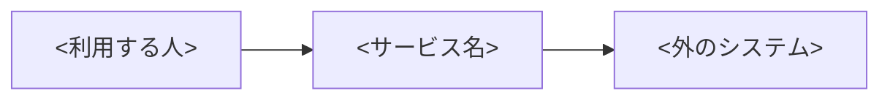
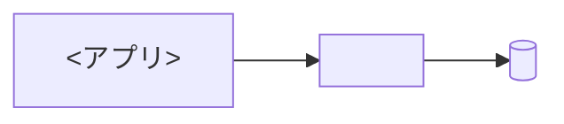
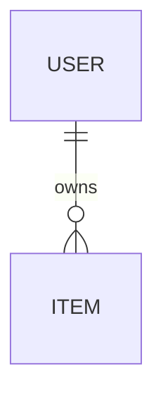

# <サービス名> 基本設計

この文書には、要求仕様（requirements.md）を**どう作るか**を書く。決まりそのものは requirements.md にあり、ここからはリンクする。ほかの案と比べて決めたことの理由は、判断記録（decisions/）にあり、ここからはリンクする。言葉は glossary.md の定義に従う。

---

## 1. 全体像

<システムと、それを使う人・外のシステムの関係>

## 2. 構成要素

<アプリ、API、DB、キューなど、別々に動く部品と、そのつながり>

| 部品 | 役割 | 技術 | 理由 |
|---|---|---|---|

## 3. データモデル

<エンティティ・テーブルと関係。上の図は形の例なので置き換える>

## 4. 機能ごとの設計

### 4.1 <機能>

## 5. インフラとネットワーク

## 6. セキュリティとプライバシー

## 7. 品質の確かめ方

<テスト、静的解析、CI で何を自動で確かめるか>

## 8. リポジトリ構成

<ディレクトリの分け方（アプリ、API、インフラの定義、文書）。コードがまだ無ければ、予定の構成を書く>
